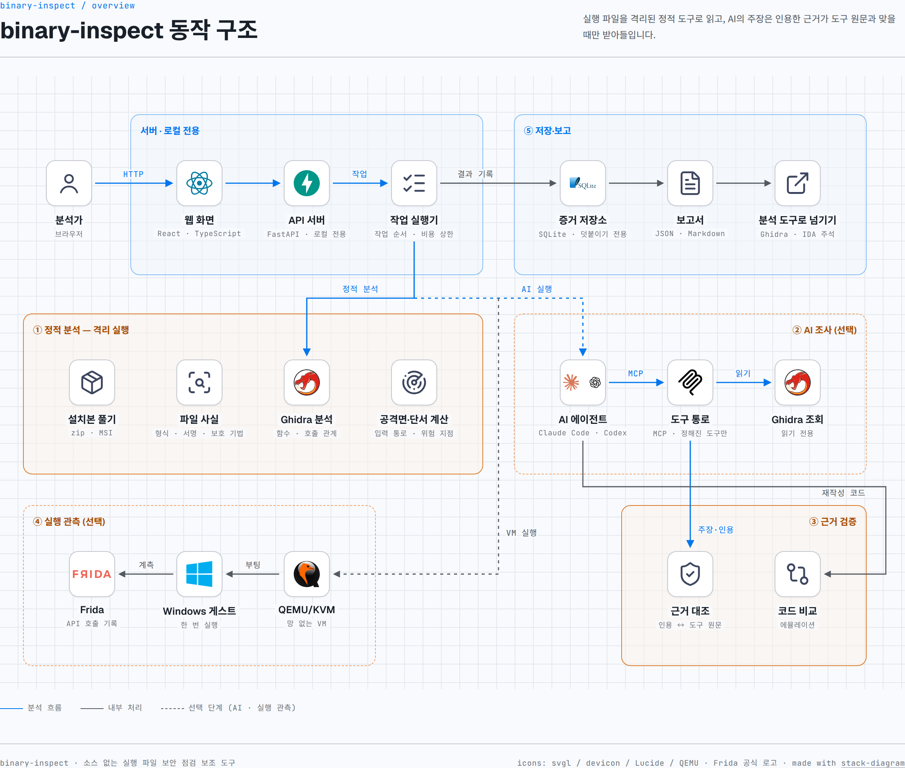
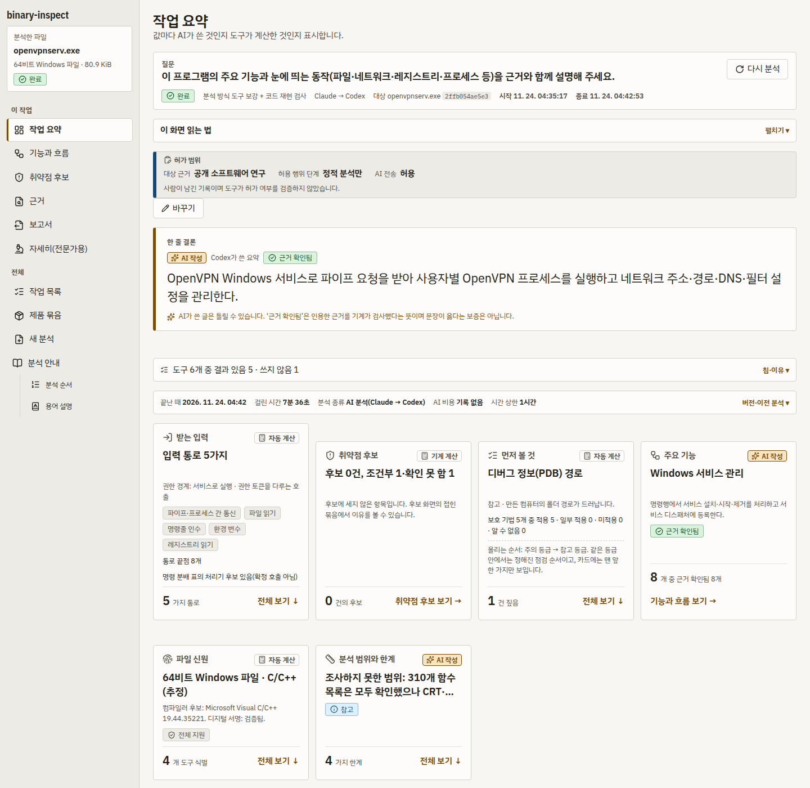
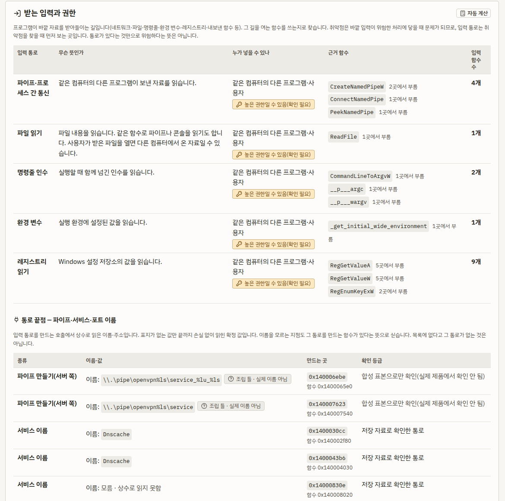
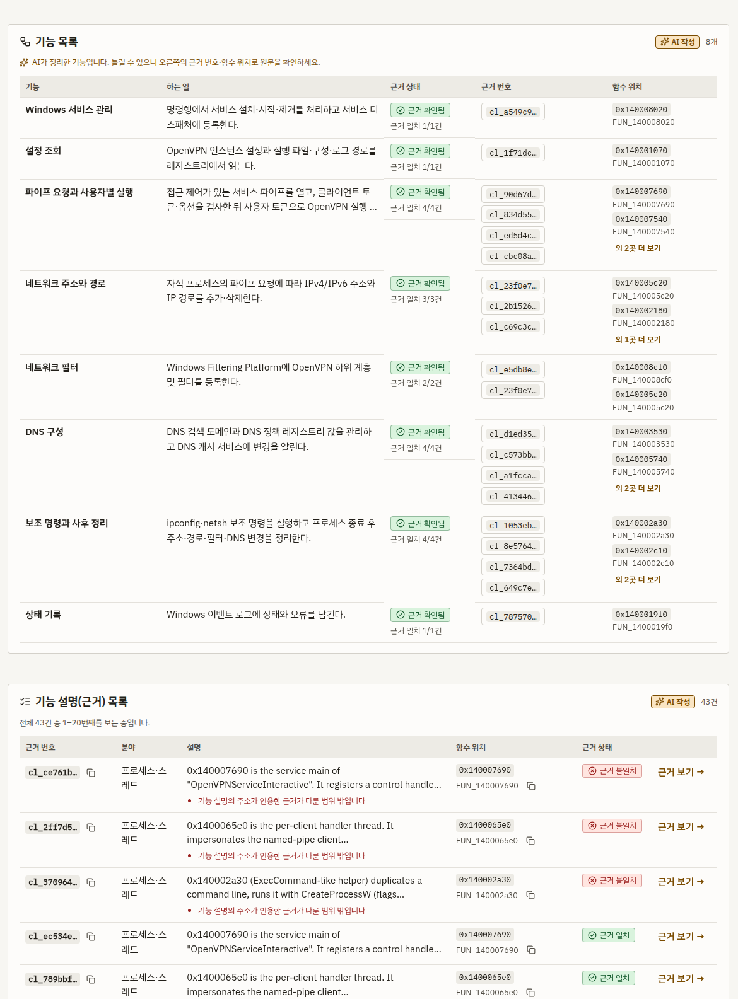
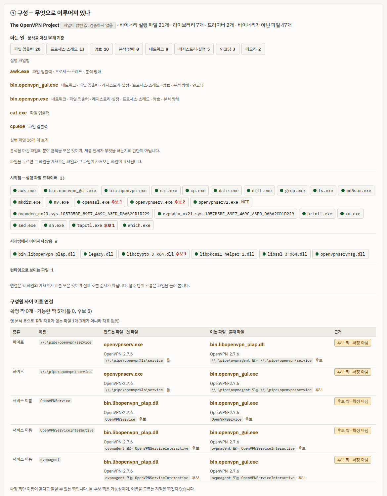

# binary-inspect — 소스 없는 실행 파일 보안 점검 보조 도구

> 프로젝트 소개용 공개 사본입니다. 소스 코드는 비공개 저장소에서 관리합니다.

소스 코드 없이 받은 실행 파일(Windows PE, Linux ELF)과 제품 설치본(zip·MSI)을 읽어, **무엇을 하는 프로그램인지 · 외부 입력이 어디로 들어오는지 · 어디가 취약해 보이는지 · 어디부터 점검할지**를 근거와 함께 정리하는 로컬 도구입니다.

| 항목 | 내용 |
|---|---|
| 문제 | 모의해킹에서는 소스 없는 제품(서비스·DLL·드라이버 수십 개)을 짧은 시간에 훑어야 하는데, 사람이 하나씩 읽기에는 느리고 AI에 맡기면 그럴듯하지만 틀린 설명이 섞인다 |
| 접근 | 정적 분석 도구가 사실과 단서를 뽑고, AI는 그 위에서 주장·판정하며, 도구가 AI의 인용 근거를 원문과 대조해 맞는 것만 받아들인다 |
| 환경 | Ubuntu 24.04 한 대, 브라우저 화면 |
| 규모 | 제품 코드 약 75,000줄(Python·TypeScript), 시험 코드 약 57,000줄 |

## 주요 기능

- **기능·공격면 파악**: 파일별 하는 일, 외부 입력 통로(파이프·포트·서비스·RPC·COM·로컬 웹 서버)와 이름, 누가 넣을 수 있는지
- **취약점 후보 찾기**: 하드코딩된 비밀값, 약한 암호, 인증서 검증 끄기, 명령 주입, 열린 접근 권한, DLL 하이재킹, 출처 확인 없는 로컬 서버, 알려진 취약 라이브러리 판을 기계 단서로 뽑고 AI가 후보·조건부·아님으로 판정
- **제품 묶음 분석**: zip·MSI 설치본을 격리 안에서 풀어 구성원 관계, 파일 사이 이름 연결, 권한 경계, 서명 검증, 먼저 볼 파일 순위
- **근거 검증**: AI 주장이 인용한 근거를 도구 원문과 대조하고, AI가 다시 쓴 코드를 원본 함수와 에뮬레이션으로 비교
- **실행 관측(선택)**: 망 없는 격리 VM에서 한 번 실행해 API 호출 기록
- **사람 판정·보고**: 확인됨·오탐·보류 기록, 발견 항목 보고서, Ghidra·IDA 주석으로 넘기기

## 동작 구조

## 차별점

1. **AI는 주장하고 도구는 검사합니다.** 인용한 근거가 도구 응답과 다르면 거부하고, "근거 확인됨"과 "문장이 옳음"을 화면에서 구분합니다.
2. **도구는 판정하지 않습니다.** 결과는 사람이 확인할 후보이며, "없음"과 "못 봄"을 구분해 보여 줍니다.
3. **신뢰할 수 없는 입력을 격리합니다.** 외부 분석 도구는 모두 격리 안에서 고정된 판으로 돌고, AI는 정해진 도구 통로로만 바이너리를 읽습니다.
4. **측정 기준을 먼저 고정합니다.** 유료 측정은 결과를 보기 전에 기준을 등록했고, 미달도 그대로 기록합니다.

## 측정 결과 (요약)

- 기계 단서 추출: 실제 프로그램 8개 파일에서 정답 단서 22/22, 기대하지 않은 단서 0
- 알려진 CVE 판·수정 판 22개: 정상 코드를 후보로 잘못 올린 비율 0%. 다만 실제 결함도 대부분 '조건부'로 남겨, 결함을 찾아내는 능력은 아직 입증 전입니다.

## 화면

공개 소프트웨어 OpenVPN 2.7.6 Windows 설치본을 분석한 화면입니다.

| 작업 요약 | 받는 입력과 권한 |
|---|---|
|  |  |
| **근거 대조** | **제품 구성** |
|  |  |

## 기술 스택

Python · FastAPI · SQLite · React · TypeScript · Ghidra · MCP · Claude Code / Codex CLI · capa · FLOSS · Unicorn · QEMU/KVM · Frida · pytest · Vitest

## 현재 상태

로컬 서버로 운영 중입니다. 공개 소프트웨어 설치본으로 처음부터 보고서까지 점검해 봤고, 실제 결함 탐지 성능은 표본을 늘려 측정하고 있습니다.
